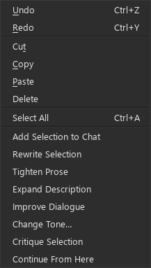
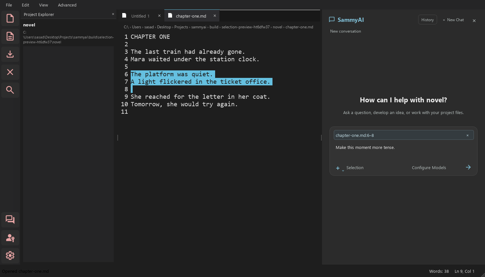

# Story-focused selection actions

Select a passage in a document tab and right-click to work on that passage:

| Action | Result |
| --- | --- |
| Rewrite Selection | Rephrases the passage while preserving meaning and story facts |
| Tighten Prose | Removes repetition and unnecessary words |
| Expand Description | Adds sensory detail consistent with the scene |
| Improve Dialogue | Improves voices, rhythm and subtext |
| Change Tone… | Asks for a tone, then proposes a replacement |
| Critique Selection | Returns feedback in chat without a document edit |
| Continue From Here | Proposes an insertion at the cursor, preserving the text after it |

All actions except Continue From Here need a selection. If text is selected,
Continue uses the cursor end of that selection as its insertion point. Canceling
the tone dialog sends nothing. Cut, Copy, Paste, Select All and spelling suggestions
remain available. The composer's right-click menu has normal editing and spelling
actions; story actions belong to document editors.

## Ask about a passage without pasting it

When chat is open, highlighting text displays a compact reference such as
`chapter.md:80` or `chapter.md:80–95` above the composer. These are logical document
lines, independent of visual word wrapping. Only your typed instruction appears
in the composer; the referenced passage is sent separately.

Automatic references follow the active editor selection. Use **Add Selection to
Chat** to open chat and pin that reference, including when switching to another
tab. Only one passage is attached at a time. Use **×** to remove it and send an
ordinary chat message. References and typed drafts are kept separately for each
conversation during the current app session; unsent references are not restored
after restart.

While a reference is attached, the composer shows **Selection** in place of the
agent picker. This is a dedicated single-call workflow using the currently
selected model. Ask a question for feedback, or ask for a revision to receive an
inline review. Removing the reference restores the selected agent workflow.

## Review, cancel and regenerate

No selection action immediately replaces your writing. Proposed changes open in
the original document's inline review. Accept or reject the hunks, then apply.
Clean project files use safe file application and change-set history for undo/redo.
Untitled and unsaved documents apply to the draft and use normal editor Undo/Redo.

You can switch editor tabs while a request runs. Editing, closing, renaming or
externally changing the source, or changing projects, makes a pending response
stale. Select the current passage and regenerate; SammyAI will not guess where
the old result belongs. Empty, truncated, malformed and provider-error results
leave the source untouched and show an explanation.

**Cancel** abandons a pending selection request and ignores any late response.
The provider may still finish its in-flight network call. The existing model
lock serializes calls. Conversation controls stay disabled while a request runs.

## What reaches the model

Each action sends the exact selected text, up to **1,500 characters before** it
and **1,500 after** it, the display filename, logical line range, format identifier,
and the requested operation or typed instruction. Continue sends an empty selection
with context on either side of the insertion cursor. The selection itself is not
silently shortened, so a very large selection can exceed your model's context limit.

This focused workflow does not include the rest of the document, previous chat
messages, CIN attachments, retrieved project files, or project memories. It does
not yet apply a writer style profile. Mention necessary story facts or tone in
your instruction. Normal chat without a selection reference retains its existing
context and agent behavior.

Chat history stores the compact reference, instruction, action metadata and result
summary (or critique). Optional diagnostic prompt/response capture follows the
existing [diagnostics settings](9_Chat_Agent_Diagnostics.md). A reference is an
immutable request snapshot, not a promise that line numbers still identify the
same text after later edits.
