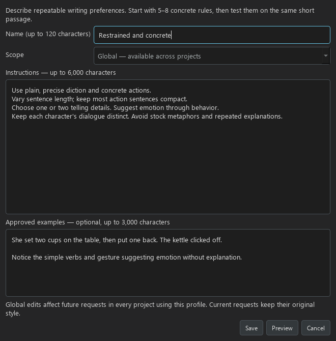
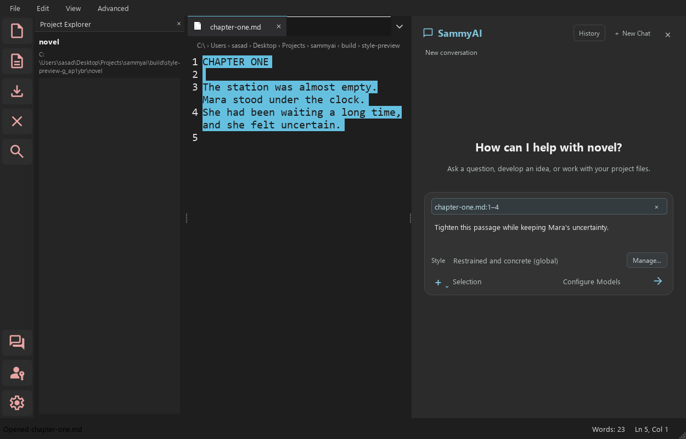
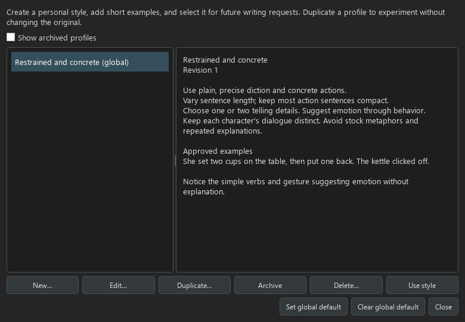

# Writer style profiles

A style profile saves the writing preferences you want SammyAI to reuse. It
can describe voice, sentence rhythm, description, dialogue, pacing, and habits
to avoid. Select a profile once and use it with Writer, Editor, or story actions
on a selected passage. Your current request takes priority when it conflicts
with a saved preference.

Profiles help communicate your choices consistently. They do not train a model
on your work or guarantee identical results across models. Start with a few
clear preferences and refine them against writing you know well.

## Create and select your first profile



1. Open chat and find **Style**, above the workflow/model controls. Select
   **Manage…**. You can also right-click in the editor and choose **Manage
   writer styles…**.
2. Choose **New…**. Give the profile a recognizable name, such as
   “My fiction — restrained and concrete.”
3. Choose **This project** for preferences particular to this story, or
   **Global — available across projects** for a reusable personal style.
4. Write a short set of instructions. The method and examples below provide
   starting points you can edit in your own words.
5. Optionally add a short **Approved examples** excerpt and explain what you
   want SammyAI to learn from it: rhythm, diction, detail, or dialogue.
6. Choose **Preview** to inspect the instructions and examples locally, then
   **Save**. Neither action sends anything to a model.
7. Select the profile in the Style dropdown, or select it in the manager and
   choose **Use style**. Creating a profile does not activate it automatically.
8. Test it on a short passage using **Rewrite Selection**. Review the proposal
   before accepting it. Try **Critique Selection** to get feedback without an edit.

The Style dropdown remains visible when a passage is attached and the workflow
label changes to Selection. The editor's right-click menu also shows the
effective style. Hover over a result message to inspect the style identity and
revision used for that request; saved history and request diagnostics retain
that record.



## Turn your own writing into useful instructions

1. **Choose a representative passage.** Pick roughly 150–300 words of your own
   writing that you like. Choose a typical passage rather than an unusual dream
   sequence or a single character's distinctive speech.
2. **Describe observable choices.** Look at sentence lengths, verbs, imagery,
   narrative distance, dialogue, and how emotions are expressed. Write what is
   on the page, not just how you hope readers will feel.
3. **Write 5–8 positive rules.** “Use concrete actions before naming an emotion”
   is easier to act on than “Make it powerful.” Add a few avoidances where useful.
4. **Separate style from story facts.** Character biographies, setting facts,
   and plot events belong in story context or project memory. “Give each speaker
   a distinct rhythm” is a style preference; “Mara is the captain” is a story fact.
5. **Give rules room to breathe.** Prefer “Use mostly short sentences, with
   occasional longer ones for reflection” to “Every sentence must be short.”
6. **Add a small example.** Label what the excerpt demonstrates. Keep examples
   short enough that the instructions remain easy to inspect.
7. **Compare the same task with and without the profile.** Keep the passage,
   prompt, model, and model settings fixed. Use an explicit No style profile
   choice for the comparison. Test several outputs before judging a change.
8. **Change one or two rules at a time.** Duplicate the profile before a larger
   experiment. Keep the version that produces useful edits while preserving
   your facts, characters, and meaning.

| Vague or rigid instruction | More useful alternative |
| --- | --- |
| Write beautifully | Prefer concrete images and precise verbs; use figurative language sparingly |
| Make everything cinematic | Convey physical action through observable movement and spatial relationships |
| Never use long sentences | Keep most action sentences compact; allow longer sentences for connected observations |
| Give everyone witty dialogue | Let humor arise from each character's outlook; preserve differences in diction and confidence |
| Avoid all exposition | Introduce background when the reader needs it, using concise explanation or relevant action |
| Always make the scene tense | Preserve the scene's intended mood; build tension through uncertainty when the task calls for it |

There is no universal best profile. Useful profiles describe choices you
recognize and want to repeat. Instructions that sound impressive but cannot
be evaluated on the page are difficult to refine.

## A reusable personal-style template

Copy this into Instructions and replace the bracketed guidance. Remove any
category that does not matter to you.

```text
Voice: [Describe the narrator's diction and distance from the scene.]
Rhythm: [Describe sentence variation and paragraph movement.]
Description: [Say which details deserve attention and how much is enough.]
Emotion: [Describe how inner feeling should appear on the page.]
Dialogue: [Describe speech, subtext, and how character differences survive.]
Pacing: [Describe when to linger and when to move quickly.]
Avoid: [List two or three recurring habits you do not want.]
Flexibility: Preserve the passage's facts and viewpoint. Adapt these preferences
to the current task rather than forcing every passage into the same pattern.
```

## Sample 1: restrained, concrete fiction

**Name:** Restrained and concrete

**Instructions:**

```text
Use plain, precise diction and concrete actions. Keep the narrator observant
rather than explanatory.
Prefer compact sentences, with occasional longer sentences when observations
belong together. Vary openings and avoid a mechanical short-short-short rhythm.
Choose one or two telling details rather than describing every object.
Suggest emotion through behavior, attention, and hesitation before naming it.
Keep dialogue specific to each character. Let pauses and evasions carry subtext
when appropriate; do not make every exchange cryptic.
Use figurative language sparingly. Avoid stock metaphors and explanations that
repeat what the action has already shown.
Preserve story facts, viewpoint, and character differences unless the request
explicitly changes them.
```

**Approved examples:**

```text
She set two cups on the table, then put one back. The kettle clicked off.
She left it where it was.

What to preserve: simple verbs, a concrete gesture suggesting emotion, and
room for the reader to infer meaning. Do not reuse the cups or kettle as facts
in another story.
```

Try this profile with Tighten Prose and Rewrite Selection. If results become
too clipped, revise the rhythm rule before adding more instructions.

## Sample 2: sensory, reflective prose

**Name:** Sensory and reflective

**Instructions:**

```text
Use an attentive, reflective narrative voice grounded in the viewpoint
character's immediate experience.
Allow flowing sentences for connected sensations or thoughts. Use shorter
sentences at moments of decision or interruption.
Choose sensory details that influence the character's attention, memory, or
next action. Avoid a checklist of all five senses in every paragraph.
Use occasional fresh comparisons drawn from the scene or character's knowledge.
Keep images coherent; avoid stacking several metaphors for the same object.
Give interior reflection a clear connection to the present scene and return
to action before the passage loses momentum.
Keep dialogue more immediate than narration and preserve each speaker's diction.
When asked to tighten, remove repetition while keeping the most useful image.
```

**Approved examples:**

```text
Warm dust rose from the curtains when she drew them apart. For a moment the
room smelled like the afternoons she had spent here as a child. Then a bus
braked outside, and the room was only a room again.

What to preserve: sensation leading into a brief reflection, then a concrete
sound returning attention to the present. The example's memories are not facts
about the current viewpoint character.
```

Try this profile with Expand Description and Continue From Here. If results
become ornate, reduce the comparison rule and specify which details earn space.

## Sample 3: dialogue with distinct voices

**Name:** Character-led dialogue

**Instructions:**

```text
Preserve each speaker's established vocabulary, confidence, and conversational
habits. Do not give every character the same wit or rhythm.
Let lines pursue an immediate intention: asking, avoiding, persuading, testing,
or reassuring. Allow direct answers when they fit the relationship.
Use subtext where the situation supports it. Do not hide ordinary information
just to make an exchange mysterious.
Keep speech readable and natural. Use contractions where appropriate, without
adding repetitive filler, phonetic accents, or hesitation to every line.
Place brief action beats where they clarify attention, timing, or a change in
power. Avoid a gesture after every spoken line.
Do not turn disagreement into banter unless the characters already speak that way.
```

**Approved examples:**

```text
“You kept the receipt?”
“You said it was expensive.”
“That wasn't why I asked.”
He smoothed the folded paper against his knee.

What to preserve: different immediate intentions and a small physical action
that leaves the relationship open to interpretation. Do not copy these lines
or invent this relationship in an unrelated passage.
```

Try Improve Dialogue and Critique Selection on the same exchange. Judge whether
speakers remain distinguishable and whether the revision preserves their intent.
These sample passages are original examples provided for adaptation.

## Scope and workflow behavior



- **Global profiles** are available across projects. **Set global default** in
  the manager chooses the style used outside a project and by projects that
  inherit the default. **Clear global default** turns that default off.
- **Use global default** lets a project follow future changes to the default.
  Selecting a specific global profile pins that choice for the project.
- **No style profile** explicitly turns the new style layer off for a project,
  even when a global default exists. Normal chat may still include existing
  STYLE memories and other context.
- **Project profiles** are available only within their owning project. Duplicate
  a profile and choose a different scope to make a separate copy.
- **Archive** removes a profile from normal selection; **Show archived profiles**
  lets you restore it. Archive/delete clears explicit selections. Restore does
  not reactivate it. Permanent deletion asks for confirmation.
- Global edits affect future requests in every project selecting that profile.
  Editing, switching, archiving, or deleting a profile during generation does
  not change the style used by that request or its later Writer stages.

Writer uses the profile for drafting and revision; its evaluator checks
adherence. Editor applies it within the requested edit scope. Critic and
Critique Selection assess relevant preferences without adopting the profile's
voice. Assistant and Brainstormer retain their existing behavior in this release.

All story editing actions use the selected profile, including custom revision
requests through an attached passage. Change Tone follows the tone you request
while retaining compatible preferences. Tighten still tightens and Expand still
expands. Custom questions remain questions; a profile does not authorize an edit.

## What reaches the model and how to troubleshoot

Instructions and approved examples are sent to your selected provider whenever
the workflow uses the profile. Selection actions still send only their focused
passage context plus the profile; they do not gain chat history or retrieved
project files. Review the [selection input details](11_Selection_Actions.md).

Names are limited to 120 characters, instructions to 6,000, and examples to
3,000. Shorter profiles are often easier to evaluate. Oversize instructions or
examples are rejected rather than silently shortened. A model with a small
context window may require a shorter profile or passage; the profile is not
silently dropped to fit. Provider failures leave the source unchanged.

If the style seems absent, check the selected workflow, the effective Style
label, and the result's captured style details. If the style overwhelms the
passage, remove absolute rules and repeated instructions. If a requested tone
differs from the profile, that override is intentional. If a saved profile is
missing or invalid, SammyAI reports the issue and uses no profile rather than
silently selecting another one.

The local profile database stores your instructions and examples. Ordinary
request diagnostics record identity, revision, and hashes; full profile text
appears in diagnostics only when prompt capture is enabled. See
[diagnostics settings](9_Chat_Agent_Diagnostics.md). A hash identifies content;
it cannot recover deleted profile text when capture was off.
